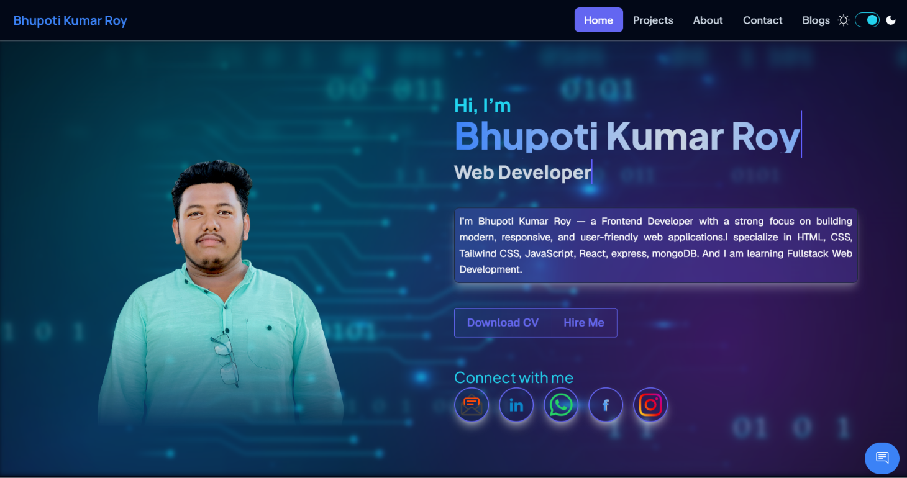

# 🚀 Modern Portfolio Frontend (Client)

A modern, responsive, and fully customizable portfolio web application (frontend + backend) built to showcase projects, skills, and experience.

---

## 🌐 Live Demo

🔗 https://bhupoti.onrender.com

---

## 📸 Preview

---

## ✨ Features

- ⚡ Modern and clean UI/UX design
- 🌙 Light & Dark mode (theme toggle with persistence)
- 📱 Fully responsive (mobile, tablet, desktop)
- 🧭 Dynamic navigation with active link highlight
- 🎯 Featured projects showcase
- 📂 JSON-based dynamic content (easy to manage)
- 🔄 Reusable and scalable component structure
- 🎨 Styled with Tailwind CSS + DaisyUI
- ⚙️ Easy customization for personal branding

---

## 🛠️ Tech Stack

- ⚛️ React
- 🎨 Tailwind CSS
- 🌼 DaisyUI
- 🔀 React Router
- ⚡ Vite

---

## 📁 Project Structure
